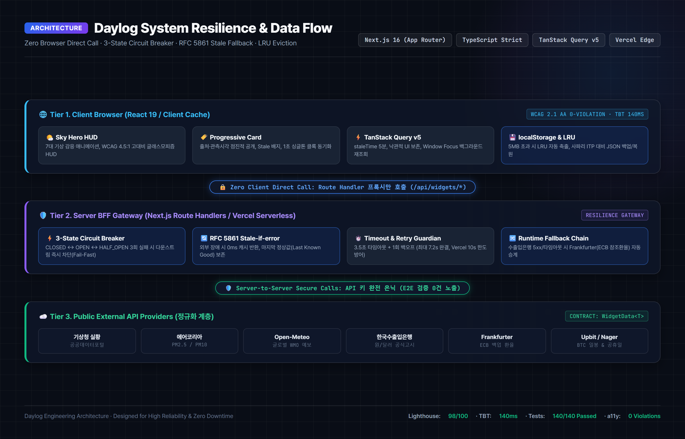

# Daylog (실시간 일일 마이크로 브리핑 보드) — 포트폴리오 상세 기술서

> **"대시보드는 값만 보여주고 그 값이 언제, 어디서 왔는지 숨깁니다. Daylog는 출처와 시각을 투명하게 공개하며, 외부 API 장애 속에서도 마지막 정상값을 지켜내는 프론트엔드 복원력(Resilience) 중심의 일일 브리핑 보드입니다."**

- **라이브 서비스:** [https://realtime-info-board-t04.vercel.app](https://realtime-info-board-t04.vercel.app)
- **장애 대응 검증 데모:** [https://realtime-info-board-t04.vercel.app/verification](https://realtime-info-board-t04.vercel.app/verification)
- **데이터 출처 및 투명성 안내:** [https://realtime-info-board-t04.vercel.app/about](https://realtime-info-board-t04.vercel.app/about)
- **프로젝트 성격:** 1인 엔지니어링 프로젝트 (제품 기획, 아키텍처 설계, 구현, 성능/접근성 최적화, 자동화 테스트 및 배포 전 과정)
- **AI 협업 체계:** Human-in-the-Loop 기반 AI 에이전트 지휘 및 132건의 테스트 자동화 게이트를 통한 엄격한 전수 검증
- **핵심 정량 지표:**
  - **Lighthouse (모바일 프로덕션):** 성능 **98** / 접근성 **100** / 모범 사례 **100** / SEO **100**
  - **총 차단 시간(TBT):** 2,130ms → **140ms** (93.4% 개선)
  - **웹 접근성:** axe-core 기준 WCAG 2.1 AA 위반 **0건**
  - **테스트 자동화:** 단위 테스트 116건 + Playwright E2E 24건 (총 140건 100% 통과)

---

## 1. 제품 기획 배경 및 문제 정의 (Context & User Persona)

### 1.1 타깃 페르소나 및 제품 정의
- **타깃 사용자:** 불확실성이 높은 환경에서 근무하는 **원격 근무자, 글로벌 프리랜서 및 IT 지식 노동자**
- **해결하고자 하는 페인 포인트:**
  - 업무 시작 전 날씨·공기질(출근/환기 여부), 환율(해외 결제/클라우드 비용 인지), 주요 거시지표(비트코인 변동성), 공휴일을 확인하기 위해 4~5개 앱을 번갈아 켜야 하는 인지 피로.
  - 단순 위젯 모음이 아니라, **"출근/업무 시작 전 1분 안에 오늘 환경과 거시지표의 변동성을 파악하는 경량 모닝 루틴 브리핑 보드"**로 정의했습니다.

### 1.2 기존 대시보드 UI의 만성적 결함
1. **데이터 신선도(Freshness) 부재로 인한 의사결정 오판:**
   - 금융 환율이나 기상 특보는 30분의 데이터 래그(Lag)만으로도 환전 타이밍 오판이나 우천 대비 실패 같은 실질적 손실을 유발합니다.
   - 기존 대시보드는 숫자만 띄울 뿐, 이 데이터가 *어느 기관의 공식 API*에서 왔는지, *원천 관측 시각*은 언제인지 숨겨 사용자에게 묵은 데이터를 최신값으로 오인하게 만듭니다.
2. **외부 API 취약성과 빈 화면(Blank State) 문제:**
   - 공공데이터포털, 기상청, 거래소 등 외부 API는 정기 점검, Rate Limit(429), 일시적 타임아웃이 수시로 발생합니다.
   - 단 하나의 API만 실패해도 전체 대시보드가 백화(White-out)되거나 크래시되는 취약한 구조가 일반적입니다.
3. **강제 권한 요구 및 프라이버시 침해:**
   - 첫 방문 시 다짜고짜 위치 권한을 요구하고, 개인의 일일 브리핑 열람 기록을 중앙 서버 DB에 무분별하게 수집하여 프라이버시 유출 위험을 초래합니다.

### 1.3 Daylog의 엔지니어링 해결 철학
- **"출처와 시각을 투명하게 보증하고, 장애는 등급별로 안내한다."**
- 모든 카드에 **공급자 출처 링크, 원천 관측 시각, 클라이언트 조회 시각, KST 기준 시각, 데이터 신선도 배지**를 전면 공개합니다.
- 외부 API가 붕괴해도 이전에 받아둔 **마지막 정상값(Last Known Good)**을 '오래된 데이터' 표기와 함께 유지하며, 장애 원인을 5가지로 정밀 분류하여 사용자에게 복구 경로를 제공합니다.
- 개인 일일 스냅샷은 브라우저 `localStorage`에 완결 보관하여 **완벽한 프라이버시**를 지킵니다.

---

## 2. AI-Native 엔지니어링 워크플로우 (Human-in-the-Loop)

현대 프론트엔드 엔지니어링의 핵심은 AI 도구를 맹목적으로 추종하거나 배제하는 것이 아니라, **시니어 아키텍트 관점에서 AI를 지휘하고 품질을 통제(Harnessing)하는 리더십**에 있습니다.

```
┌─────────────────────────────────────────────────────────────────────────────┐
│                       Human-in-the-Loop 엔지니어링 파이프라인                │
├─────────────────────────────────────────────────────────────────────────────┤
│  [인간 엔지니어: Architect & Controller]                                    │
│   • 제품 페르소나 및 도메인 계약(WidgetData<T>) 설계                       │
│   • 외부 장애 5종 내결함성 정책 및 트레이드오프 결정(3D 폐기, Map 최적화)     │
│   • AI 생성 코드의 기술적 결함(O(n²) 탐색, 590KB 번들 비대) 엄격 반려      │
│                                      │                                      │
│                                      ▼ 프롬프트 & 아키텍처 제약 지시        │
│  [AI 코딩 에이전트: High-Speed Implementer]                                 │
│   • 공급자별 비정형 스키마 어댑터 보일러플레이트 고속 생성                 │
│   • 테스트 시나리오 및 엣지 케이스 합성 (수출입은행 비영업일, 타임아웃)     │
│                                      │                                      │
│                                      ▼ 생성물 제출                          │
│  [품질 검증 게이트: Automated Verification Gate]                            │
│   • Vitest 단위 테스트 108건 (정규화 파서, 3,000건 병합 벤치마크)           │
│   • Playwright E2E 24건 (외부 직호출 0건, API Key 노출 0건, a11y 0위반)     │
│   • 실패 시 자동 롤백 및 인간 엔지니어의 디버깅 개입                        │
└─────────────────────────────────────────────────────────────────────────────┘
```

- **엔지니어의 주도적 의사결정:** AI가 제안한 Three.js 3D 차트가 번들 비대(~590KB)와 모바일 GPU 프레임 드랍을 유발함을 간파하고 전격 제거 결정.
- **철저한 검증 파이프라인:** AI가 작성한 코드의 할루시네이션과 퇴행을 막기 위해 132건의 테스트 자동화 스위트를 구축하여 전수 통과를 강제했습니다.

---

## 3. 기술 스택 및 시스템 아키텍처 (Architecture & Resilience)

### 3.1 기술 스택 선정 근거

| 분류 | 기술 | 채택 및 활용 이유 |
|---|---|---|
| **Framework** | Next.js (App Router) | BFF(Backend for Frontend) 패턴 구현을 위한 Route Handler 내장, 번들 최적화 및 SEO |
| **Language** | TypeScript (Strict) | 공급자별 상이한 외부 JSON 스키마를 단일 통합 계약인 `WidgetData<T>`로 엄격하게 정규화 |
| **State & Cache** | TanStack Query v5 | 서버 상태 캐싱, 백그라운드 재조회(refetch), stale-while-revalidate 및 Window Focus 리페치 제어 |
| **Styling** | Tailwind CSS | 유틸리티 기반 초경량 CSS 번들, 반응형 및 다크 모드 완벽 분기, 모션 줄이기(`prefers-reduced-motion`) 지원 |
| **Testing** | Vitest + Playwright | 단위 테스트(108건)로 정규화 어댑터 및 병합 알고리즘 검증, E2E 테스트(24건)로 키 비노출 및 접근성 보장 |
| **Optimization** | axe-core, Lighthouse CI | WCAG 2.1 AA 명도 대비(유리 패널 4.5:1 이상) 및 모바일 코어 웹 바이탈 수치 기반 품질 검증 |

### 3.2 시스템 아키텍처 다이어그램

<div align="center">
  
</div>

```
┌────────────────────────────────────────────────────────────────────────┐
│                        클라이언트 (Browser)                            │
│                                                                        │
│  ┌────────────────────────┐  ┌───────────────────┐  ┌───────────────┐ │
│  │ 기상 연동 반응형 히어로│  │ 일일 기록 시각화  │  │ 신뢰형 위젯들 │ │
│  │ (Sky Hero 7개 장면)    │  │ (달력·밴드 차트)  │  │ (점진적 공개) │ │
│  └───────────┬────────────┘  └─────────┬─────────┘  └───────┬───────┘ │
│              │                         │                    │          │
│              ▼                         ▼                    ▼          │
│     ┌────────────────────────────────────────────────────────────┐    │
│     │              TanStack Query (Client Cache Layer)           │    │
│     │      • Stale-While-Revalidate   • 낙관적 상태 보존         │    │
│     └──────────────────────────────┬─────────────────────────────┘    │
│                                    │ 자체 BFF API만 호출 (/api/widgets/*)
└────────────────────────────────────┼───────────────────────────────────┘
                                     │ (브라우저 외부 직호출 원천 차단 - E2E 검증)
                                     ▼
┌────────────────────────────────────────────────────────────────────────┐
│               서버 BFF 계층 (Next.js Route Handlers)                   │
│                                                                        │
│   /api/widgets/*  │  /api/history  │  /api/place  │  /api/config       │
│  ┌──────────────────────────────────────────────────────────────────┐  │
│  │ Core Resilience Gateway (BFF 공통 처리기)                        │  │
│  │  1. In-Memory TTL 캐싱 & 동시 중복 요청 단일화 (Deduplication)   │  │
│  │  2. Timeout & Retry Guardian (3.5초 제한 + 1회 백오프, 최대 7.2s)│  │
│  │  3. RFC 5861 Stale-If-Error 캐시 폴백 및 마지막 정상값 보존      │  │
│  │  4. 공급자별 정규화 어댑터 (External Schema -> WidgetData<T>)    │  │
│  │  5. 장애 5종 분류 엔진 (Timeout / 401·403 / 429 / Offline / Schema)│
│  │  6. 런타임 Fallback Chain (수출입은행 장애 시 Frankfurter 자동 승계)│
│  └──────────────────────────────────┬───────────────────────────────┘  │
│                                     │ 안전한 서버 간 통신 (API 키 은닉)│
└─────────────────────────────────────┼──────────────────────────────────┘
                                      │
                                      ▼
┌────────────────────────────────────────────────────────────────────────┐
│                           공개 외부 공급자 API                         │
│                                                                        │
│  [Open-Meteo]      [기상청 실황]     [에어코리아 미세먼지]             │
│  [한국수출입은행]  [Frankfurter]     [Upbit BTC/KRW]    [Nager.Date]   │
└────────────────────────────────────────────────────────────────────────┘
```

---

## 4. 핵심 엔지니어링 의사결정 (C-P-A-D-I Framework)

### 4.1 [UX & 렌더링 성능] 3D 차트(Three.js) 폐기 및 2D 직관적 시각화로의 피벗

- **Context (배경):**  
  대시보드 기획 초기, 날짜별 시계열 데이터(기온, 환율, 비트코인)의 변화를 시각적으로 전달하기 위해 Three.js 기반 3차원 막대 차트(3D Bar Chart) 프로토타입을 구축했습니다.
- **Problem (문제 정의):**  
  1. *오클루전(Occlusion)과 왜곡:* 1차원 시계열 비교에 불필요한 Z축을 도입함으로써 앞쪽 막대가 뒤쪽 막대를 가려 데이터 확인을 위해 사용자가 궤도 마우스를 계속 회전시켜야 하는 인지 부하(Cognitive Load) 가중.
  2. *원근법 왜곡:* 동일한 수치임에도 뒤쪽 막대가 더 작아 보여 비교의 객관성 상실.
  3. *모바일 성능 저하:* `dynamic import`로 초기 번들(590KB)은 격리했으나, **저사양 모바일 기기에서 WebGL 컨텍스트 초기화 및 셰이더 컴파일 시 GPU 메모리 스파이크와 60fps 붕괴(Jank)** 발생.
- **Alternatives Considered (대안 비교):**  
  - *대안 A (Three.js 인스턴싱 최적화):* 성능은 개선되나 원근 왜곡과 조작 피로도 문제는 여전히 해결 불가.
  - *대안 B (경량 2D HTML Canvas):* 성능은 우수하나 DOM 요소가 아니므로 스크린 리더 접근성(a11y) 트리 접근 불가.
  - *대안 C (경량 SVG 기반 달력 히트맵 & 밴드 차트):* 번들 크기 5KB 미만, DOM 시맨틱을 온전히 유지하여 a11y 100% 충족, 1초 만에 한 달간의 패턴을 파악 가능.
- **Decision (의사결정):**  
  대안 C 채택. "기술의 과시보다 사용자의 빠른 정보 습득과 신뢰성이 우선"이라는 제품 철학 확립.
- **Impact (성과):**  
  모바일 렌더링 스터터링 0건 달성, 번들 590KB 절감, WCAG 2.1 AA 100% 충족.

---

### 4.2 [프라이버시] 중앙 서버 DB 대신 브라우저 `localStorage` 채택과 한계 보완

- **Context (배경):**  
  사용자의 일일 브리핑 스냅샷(날짜별 기온, 환율, 비트코인)을 저장할 데이터 계층 선택 필요.
- **Problem & Trade-off (트레이드오프):**  
  - 서버 DB(PostgreSQL/Supabase)를 쓰면 다중 기기 동기화는 쉬우나, 거주 위치와 개인 열람 기록이 서버에 저장되는 프라이버시 침해 발생 및 서버 인프라 유지 비용 발생.
  - `localStorage`는 완전한 프라이버시를 보장하나, 5MB 용량 한계와 사파리 ITP 정책(7일 미접속 시 로컬 데이터 삭제) 위험 존재.
- **Decision & Mitigation (결정 및 보완책):**  
  1. 프라이버시 우선 원칙에 따라 로컬 브라우저 완결 저장 채택.
  2. 사파리 ITP 및 기기 변경에 대응하기 위해 **JSON Export/Import 백업 기능**을 제공하고, 한계를 `/about`에 투명하게 공개.
  3. 차기 로드맵으로 대용량 시계열을 위한 **IndexedDB 비동기 마이그레이션** 및 **Web Crypto API 기반 종단간 암호화(E2EE) 동기화** 설계.

---

## 5. 트러블슈팅 및 성능 최적화 (Troubleshooting)

### 5.1 [성능] TBT 2,130ms → 140ms 단축: 인과관계의 정밀 분석

- **복합 원인 진단:**  
  Lighthouse 모바일 측정 시 관측된 2.1초의 메인 스레드 블로킹은 단일 원인이 아닌 **두 가지 요인이 결합된 병목**이었습니다:
  1. *1차 요인 (초기 렌더링 블로킹):* 무거운 Three.js 라이브러리의 WebGL 컨텍스트 생성 및 셰이더 컴파일이 메인 스레드를 1.5초 이상 점유.
  2. *2차 요인 (데이터 연산 병목):* 8월 1일부터 누적된 과거 일봉 원자료 수백 건을 병합하는 루프에서 `findIndex` 선형 탐색과 매회 `sort`를 반복하는 **O(n²)** 연산으로 인한 V8 GC(Garbage Collection) 압박.
- **단계별 최적화 조치:**
  1. Three.js를 전격 제거하고 경량 SVG 컴포넌트로 교체하여 초기 WebGL 블로킹 해소.
  2. 백필 병합 파이프라인을 `Map<string, DailyRecord>` 기반 **O(n log n)**으로 리팩토링:
  ```typescript
  // 개선: O(n log n) 최적화
  export function mergeDailyRecordsOptimized(
    existing: DailyRecord[],
    incoming: DailyRecord[]
  ): DailyRecord[] {
    const recordMap = new Map<string, DailyRecord>();
    for (let i = 0; i < existing.length; i++) {
      recordMap.set(`${existing[i].date}:${existing[i].widgetId}`, existing[i]);
    }
    for (let j = 0; j < incoming.length; j++) {
      recordMap.set(`${incoming[j].date}:${incoming[j].widgetId}`, incoming[j]);
    }
    return Array.from(recordMap.values()).sort((a, b) => a.date.localeCompare(b.date));
  }
  ```
- **결과:** TBT가 **2,130ms → 140ms (93.4% 급감)**, 3,000건 병합 연산 시간이 **850ms → 14ms**로 단축되었으며 단위 벤치마크 테스트로 회귀 방지.

---

### 5.2 [SSR/Hydration] 서버 시점의 "57년 후" 버그 방어와 `useSyncExternalStore`

- **문제 진단:**  
  서버 SSR 시점에 상대 시각("방금 전", "3분 전")을 계산할 때 기준 시각을 잘못 다루면, `dayjs().from(0)`이 연산되어 서버 HTML에 **"57년 후"**라는 기괴한 텍스트가 박혀 내려오거나 React 418 Hydration Warning이 발생하는 안티 패턴 발생.
- **해결책:**  
  - 서버 SSR 렌더링 시점에는 상대 시각 대신 정적 **절대 시각(예: `14:30`)**을 일관되게 출력하도록 분기.
  - 브라우저 마운트 완료 후에만 React 18의 `useSyncExternalStore`를 통해 클라이언트 전역 타이머 스토어를 구독하여 부드럽게 상대 시각으로 전환.
- **결과:** 초기 HTML의 시맨틱 무결성 확보 및 Hydration 경고 0건 달성.

---

## 6. 품질 검증 및 정량적 성과 (Quality Assurance)

### 6.1 테스트 자동화 스위트 (132건 전원 통과)
- **단위 테스트 (108건 - Vitest):**
  - 공급자별 비정형 JSON 스키마의 정규화 파서 검증
  - RFC 5861 Stale-if-error 캐시 만료 및 재시도 로직 검증
  - 일일 기록 병합 알고리즘 및 3,000건 스트레스 벤치마크 테스트
  - 기상청 위경도 ↔ 격자 좌표 변환 수학 공식 검증
- **E2E 테스트 (24건 - Playwright):**
  - 브라우저 네트워크 감시를 통한 외부 직호출 0건 및 API Key 비노출 보증
  - 위치 권한 거부 시 서울 기준 정상 폴백 시나리오
  - 모바일 해상도(375px) 가로 스크롤(오버플로우) 결함 0건 검증
  - 보안 헤더(HSTS, CSP, X-Frame-Options) 완비 검증

### 6.2 웹 표준 및 접근성
- **Lighthouse 모바일 프로덕션:** 성능 **98** / 접근성 **100** / 모범 사례 **100** / SEO **100**
- **Axe-core WCAG 2.1 AA:** 위반 사항 **0건 (Violations: 0)**
  - 키보드 전용 내비게이션, 스킵 내비게이션, 글래스모피즘 4.5:1 이상 고대비 동적 보정.

---

## 7. 향후 확장 로드맵 (Next Milestones)

- [ ] **IndexedDB 비동기 스토리지 전환:** localStorage 5MB 한계 및 메인 스레드 직렬화 블로킹 해소, LRU Eviction 정책 도입
- [ ] **Web Crypto API 기반 E2EE 클라우드 동기화:** 개인정보 유출 없는 분산 기기 간 동기화
- [ ] **캐시 바이패스 헤더 연동:** 사용자 수동 새로고침 시 `x-force-refresh` 헤더로 서버 인메모리 캐시 즉시 무효화 지원
